# TIAGo Mobile Manipulation in ROS 2

**Autonomous navigation, 3D perception and pick-and-place with PAL Robotics' TIAGo, in simulation.**

Author: **Promise Emeziem Adiole**

[](https://docs.ros.org/en/humble/)
[](https://classic.gazebosim.org/)
[](https://moveit.ai/)
[](https://docs.nav2.org/)
[](https://www.python.org/)
[](LICENSE)

<p align="center">
  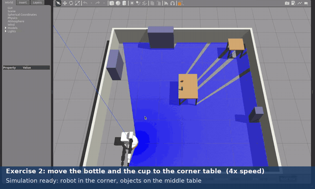
  <br><em>Exercise 2, start to finish (4× speed): TIAGo finds the bottle and the cup with its RGB-D camera, picks each one,
  carries it across the room and places it on a free spot of the corner table. Full video: <a href="video/demo.mp4">video/demo.mp4</a>.</em>
</p>

A complete mobile-manipulation stack for TIAGo on ROS 2 Humble. The robot model, the controllers, the map, the
localisation, the MoveIt configuration and all of the task code were set up or written for this project:

- **Exercise 1:** TIAGo starts in a corner of a room, drives to the middle table (Nav2) and places its gripper right above the table, pointing down (MoveIt).
- **Exercise 2:** TIAGo moves a bottle and a cup from the middle table to a table in the corner **autonomously**, finding each object's 6-DOF pose with its head RGB-D camera, and checking every grasp and placement with the camera.

📄 **[Report](report.pdf)** (5 pages: decisions, results, sources) ·
🛠 **[Installation](INSTALL.md)** ·
🎬 **[Demo video](video/demo.mp4)** (2 minutes)

---

## Results

| Task | Script | Result (fresh simulation each run) |
|---|---|---|
| Exercise 1 | `my_tiago_tasks/exercise1.py` | **5 of 5 runs**: gripper pointing down, fingertips 0.29–0.31 m above the table top; 41–66 s |
| Exercise 2 | `my_tiago_tasks/exercise2.py` | **4 of 4 runs**: bottle and cup upright on the corner table (Gazebo ground truth), cup to the right of the bottle, 15–20 cm apart, at least 14 cm inside the table edges; 7–9 min |

<table>
  <tr>
    <td width="50%">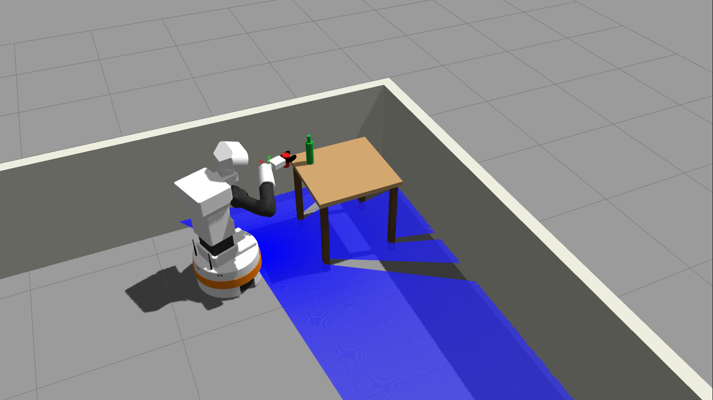</td>
    <td width="50%">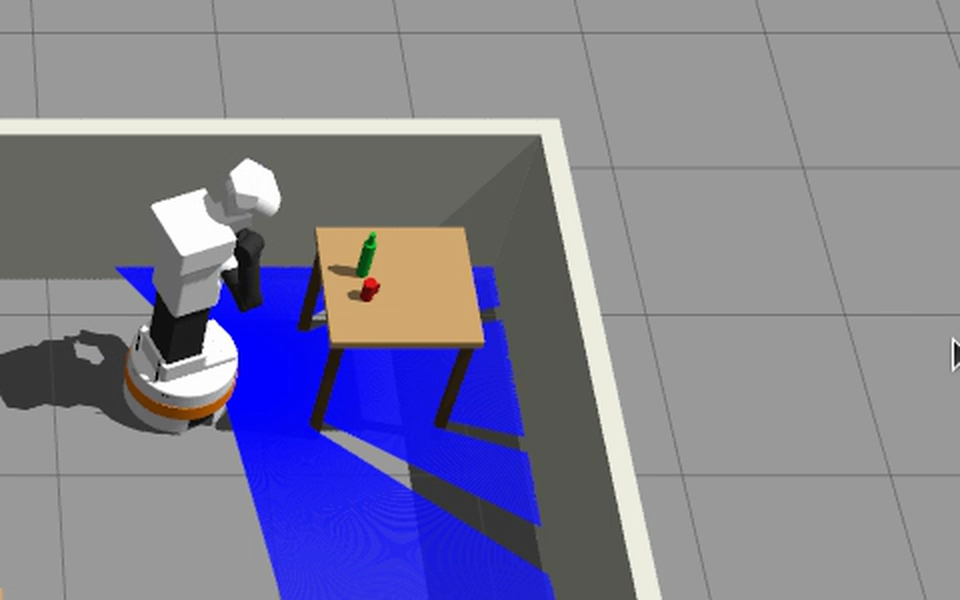</td>
  </tr>
  <tr>
    <td align="center"><em>The cup in the gripper at the middle table.</em></td>
    <td align="center"><em>Result: bottle and cup upright on the corner table.</em></td>
  </tr>
</table>

## Highlights

- **Sensor fusion that fixed a real failure.** Turning on the spot made the wheels slip, wheel odometry lost its heading, and Nav2 drove the robot towards the table instead of home. An **EKF fusing wheel odometry with the IMU** (`robot_localization`) fixed it: 4 of 4 consecutive navigation goals reached, AMCL within **0.11 m and 4°** of ground truth.
- **Geometric 3D perception from one RGB-D snapshot.** RANSAC table-plane fit, PCA of the table outline, grid clustering of the points above it, and a least-squares circle fit per object give each object's 6-DOF pose: position error about **2 cm**, height and radius within **2 mm**.
- **Closed-loop task execution.** The camera confirms every step: after lifting, the object must be gone from the table; after placing, it must be on the target table. A free place spot is chosen from the detected table outline and the objects already on it.
- **A patched Gazebo plugin.** The link attacher that holds grasped objects in simulation could freeze or crash Gazebo when releasing an object. Two thread-safety and bookkeeping bugs were found and fixed (`patches/`).
- **Measured, not assumed.** Every component was tested against Gazebo ground truth before the next one was built; over 30 problems were traced to their cause and fixed along the way.

## System overview

<p align="center">
  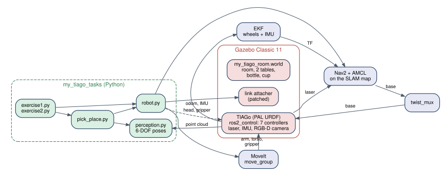
  <br><em>The Python task code talks to Nav2, MoveIt, the controllers and the link attacher through one interface class, <code>robot.py</code>.</em>
</p>

<table>
  <tr>
    <td width="55%">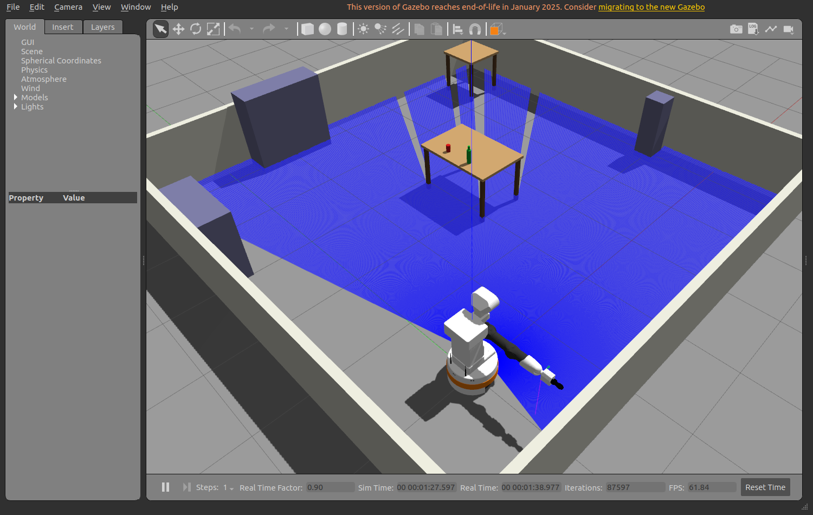</td>
    <td width="45%">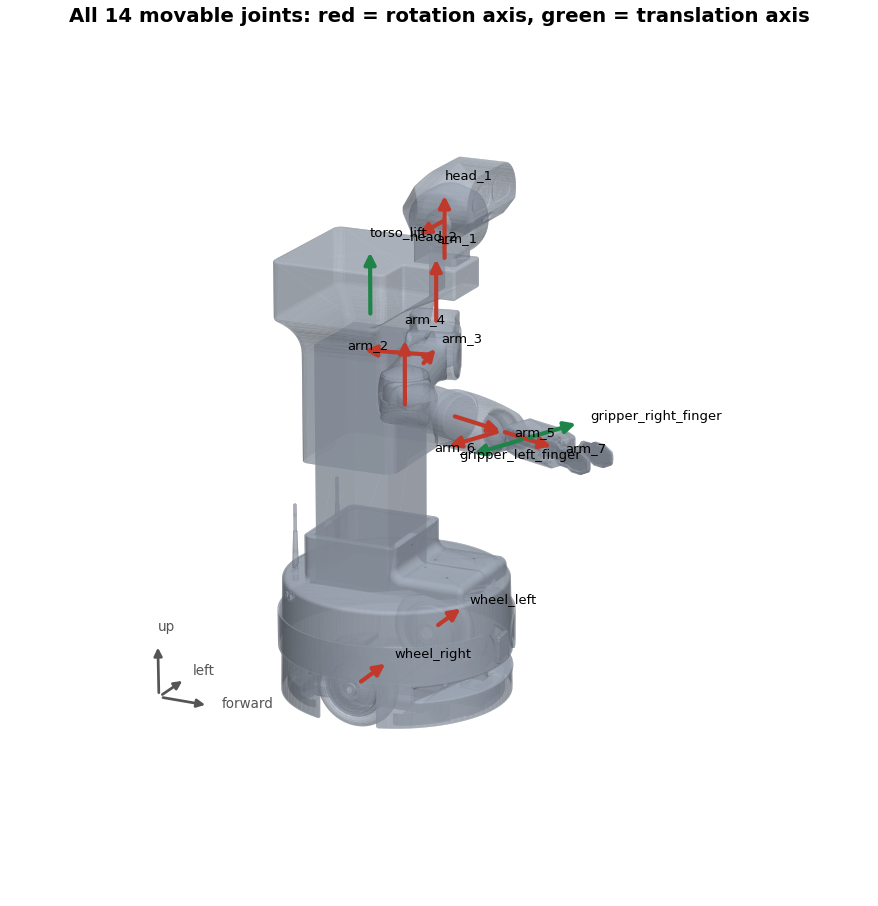</td>
  </tr>
  <tr>
    <td align="center"><em>TIAGo in the custom simulated room (blue: laser rays). Middle table with the cup (red) and the bottle (green); corner table at the back.</em></td>
    <td align="center"><em>The 14 movable joints: differential-drive base, prismatic torso, 7-DOF arm, parallel gripper, pan-tilt head.</em></td>
  </tr>
</table>

## How it works

### 1. Mapping and localisation

The room was mapped with **slam_toolbox** using the base laser. Fast spins smeared the map with ghost walls; turning
at 0.25–0.3 rad/s gave a clean 6.65 m map that matches the 6.6 m room.

<p align="center">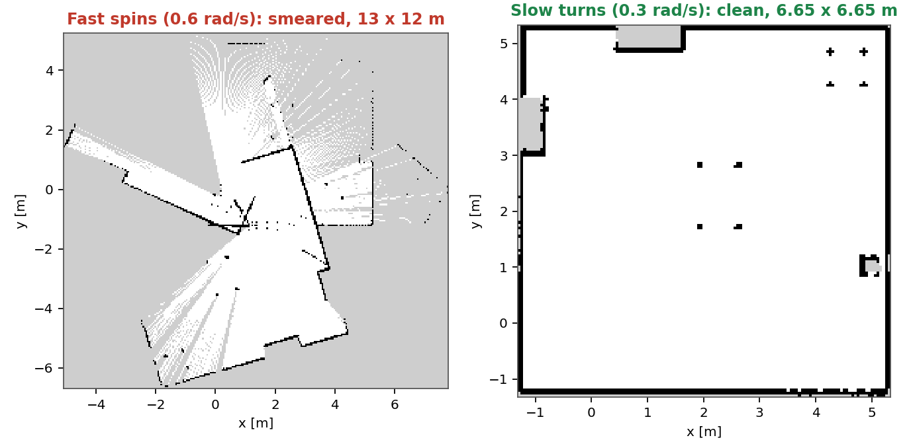</p>

With the map, **AMCL** (a particle filter matching laser scans to the map) localises the robot. On its own, wheel
odometry failed whenever the robot turned on the spot: the wheels slipped, the heading estimate was off by about 77°,
and the robot got lost. An **Extended Kalman Filter** now fuses the wheels' velocities with the IMU's yaw and yaw rate
and publishes `odom → base_footprint`; AMCL corrects the remaining slow drift with `map → odom`.

<p align="center">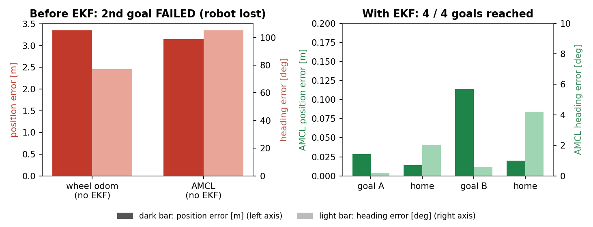</p>

### 2. Navigation

**Nav2** plans on the global costmap and follows the path with its local controller; `twist_mux` lets a keyboard
override Nav2 at any time. The task code calls Nav2 through the Simple Commander API.

<p align="center">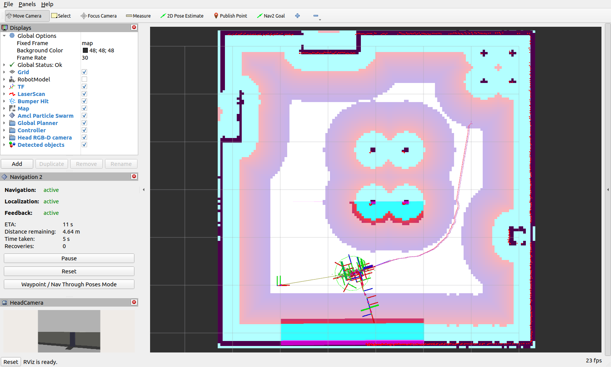</p>

### 3. Perception: from a point cloud to 6-DOF object poses

TIAGo looks at the table and takes **one** point cloud from its head RGB-D camera (640×480). The cloud is
transformed into the robot frame with TF and processed with NumPy (`my_tiago_tasks/perception.py`):

<p align="center">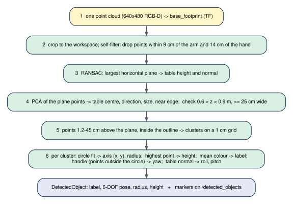</p>

- **RANSAC** (3-point samples, 300 hypotheses, 8 mm inlier band, horizontal planes only) finds the table plane, then a least-squares SVD refit sharpens it. The points that do *not* fit the plane are the objects.
- **Grid clustering** (1 cm cells, connected components) separates the objects; clusters under 80 points are treated as noise.
- A **circle fit** on each cluster's top-down projection recovers the cylinder's axis even though the camera only sees its front half. The height comes from the highest points, the label from the mean colour, and a cup's yaw from its handle (points outside the circle).
- The robot's own arm and hand are removed from the cloud first (self-filter), so a held object is never detected as standing on the table.

### 4. Manipulation

**MoveIt 2** plans for the 8-joint group `arm_torso` (torso lift + 7-DOF arm). The configuration was generated with the
Setup Assistant and then corrected by hand: the real controllers, 260 disabled collision pairs, and the end effector.

<table>
  <tr>
    <td width="55%">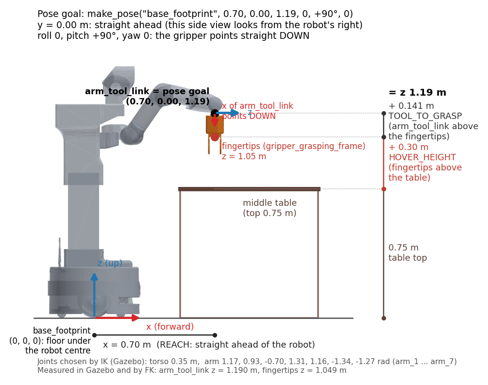</td>
    <td width="45%">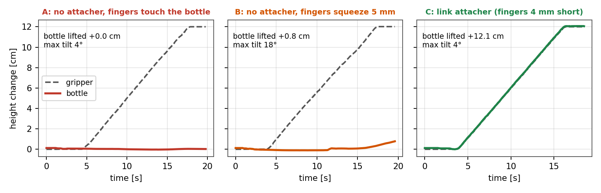</td>
  </tr>
  <tr>
    <td align="center"><em>Exercise 1's pose goal on the robot model: gripper pointing down above the table, within the arm's ~0.72 m reach.</em></td>
    <td align="center"><em>Why the link attacher is needed: only with it does the bottle follow the gripper (+12.1 cm for a 12.0 cm lift).</em></td>
  </tr>
</table>

The pick sequence: position the base so the object is reachable, plan to a pre-grasp pose, approach in a straight
line, close the fingers, attach, lift, and **check with the camera** that the object has left the table.
For placing, the robot detects the corner table, chooses a free spot next to the objects already there, and checks the
result with the camera again.

<p align="center">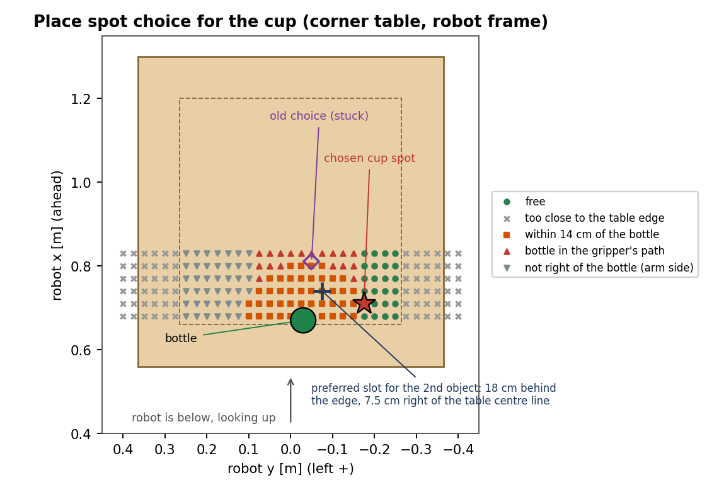</p>

## Engineering challenges

Selected issues identified and resolved during development:

| Symptom | Root cause | Resolution |
|---|---|---|
| Robot lost after turning on the spot | Wheel slip corrupted the odometry heading | IMU-aided EKF |
| Smeared SLAM map with ghost walls | Fast spins, wheel slip | Map at 0.25–0.3 rad/s |
| Nav2 nodes die: "free participant index" | CycloneDDS loopback participant limit (~10) | `MaxAutoParticipantIndex 100` in `CYCLONEDDS_URI` |
| Gazebo freezes or crashes on object release | Plugin changed joints from the service thread while physics was stepping | Pause the world around the change (`patches/`) |
| Top-down gripper pose unreachable | Nav2 stopped short; target beyond the ~0.72 m reach | Target set 0.70 m ahead of where the robot actually stopped |
| "Grasped" reported although the grasp failed | No table in view counted as "object gone" | Grasp check requires the table to be seen |

## Original contributions and third-party components

**Developed in this project**

| Component | Location |
|---|---|
| Simulation world: room, two tables, bottle, cup and furniture | `src/my_tiago_bringup/worlds/my_tiago_room.world` |
| Occupancy map of the room, built with slam_toolbox | `src/my_tiago_bringup/maps/` |
| Robot description wrapper (TIAGo with PAL gripper and Schunk F/T sensor) | `src/my_tiago_description` |
| MoveIt 2 configuration: planning groups, controllers, collision matrix | `src/my_tiago_moveit_config` |
| Controllers, EKF, twist_mux, SLAM and Nav2 configuration; launch files | `src/my_tiago_bringup` |
| Task software: robot interface, perception, pick and place, both exercises (Python) | `src/my_tiago_tasks` |
| Thread-safety and bookkeeping fix for the Gazebo link attacher | `patches/` |

**Third-party components**

| Component | Origin and use |
|---|---|
| TIAGo robot model (URDF, meshes, macros) | PAL Robotics description packages, included as source in `src/pal_description_overlay`; extended with a `use_mock_hardware` option |
| Gazebo link attacher plugin | IFRA_LinkAttacher, Cranfield University (Apache-2.0), built from source with the patch above |
| Gazebo, ros2_control, MoveIt 2, Nav2, slam_toolbox, robot_localization, twist_mux | ROS 2 Humble binary packages |

## Packages

| Package | Contents |
|---|---|
| `my_tiago_description` | `my_tiago.urdf.xacro` (TIAGo with PAL gripper and Schunk F/T sensor), RViz model view |
| `pal_description_overlay` | `tiago_description`, `pmb2_description`, `pal_gripper_description`, `pal_urdf_utils` |
| `my_tiago_moveit_config` | SRDF (groups `arm`, `arm_torso`, `gripper`), kinematics, MoveIt controllers |
| `my_tiago_bringup` | launch files (Gazebo, MoveIt, mapping, navigation), controllers, EKF, twist_mux, SLAM and Nav2 parameters, world, map, RViz configurations |
| `my_tiago_tasks` | `robot.py`, `perception.py`, `pick_place.py`, `exercise1.py`, `exercise2.py`, test scripts |
| `IFRA_LinkAttacher` | Gazebo link attacher plugin and its service messages |

## Build

Requirements: Ubuntu 22.04, ROS 2 Humble, Gazebo 11 and the packages listed in [INSTALL.md](INSTALL.md), including the `~/.bashrc` settings for CycloneDDS.

```bash
cd ~/my_tiago_ws
colcon build --symlink-install
source install/setup.bash
```

## Run the exercises

Use normal Ubuntu terminals, each starting with `cd ~/my_tiago_ws && source install/setup.bash`. Start the simulation fresh (robot in its corner, objects in place) before each run.

```bash
# Terminal 1: simulation (wait for "Configured and activated ft_sensor_controller")
ros2 launch my_tiago_bringup my_tiago_gazebo.launch.xml

# Terminal 2: navigation (wait for "Managed nodes are active" twice)
ros2 launch my_tiago_bringup my_tiago_navigation.launch.xml

# Terminal 3: MoveIt (wait for "You can start planning now!")
ros2 launch my_tiago_bringup my_tiago_moveit_sim.launch.xml

# Terminal 4: one exercise
ros2 run my_tiago_tasks exercise1      # about 1 minute
ros2 run my_tiago_tasks exercise2      # about 7 minutes
```

Exercise 1 ends with `Exercise 1 complete: the gripper is above the table.`
Exercise 2 ends with `Exercise 2 result: bottle=placed, cup=placed`.
Both scripts exit with code 0 on success.

Test scripts: `ros2 run my_tiago_tasks robot_demo` (arm, head, gripper), `perception_demo` (detections compared with the world file), `pick_demo [bottle|cup]` (pick one object and put it back), `go_to_pose X Y [YAW_DEG]` (Nav2 goal).

## Next steps

- **Evaluation at scale:** random object positions and orientations, repeated runs, and a success rate per object.
- **More robust handle detection:** accept a cup's handle only if the outlying points form a compact blob, otherwise grasp it as a symmetric object.
- **Dynamic obstacles:** re-enable the laser obstacle layer in the local costmap.
- **Real robot:** the same controllers run with PAL's hardware plugin; the link attacher is replaced by the gripper's force feedback.

## License

The original code and documentation in this repository are released under the [Apache License 2.0](LICENSE).
Third-party components retain their original licences: PAL Robotics' description packages in `src/pal_description_overlay` (Apache-2.0 / BSD) and IFRA_LinkAttacher (Apache-2.0, see `src/IFRA_LinkAttacher/LICENSE.md`).
